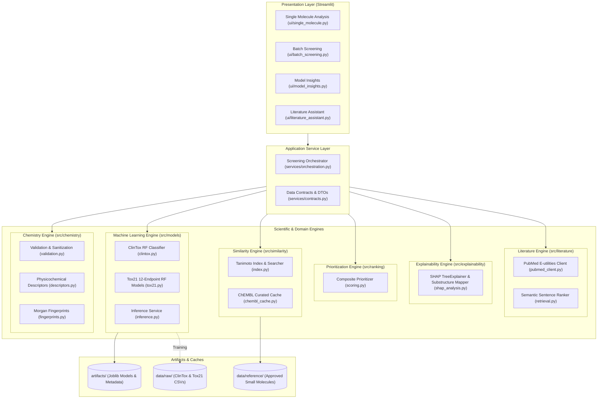

# Architecture Specification: MoleculeIQ

**Architecture Style:** Layered Modular Monolith  
**Directive Version:** 4.0  
**SRD Reference:** Section 2, Section 3  

---

## 1. System Overview

MoleculeIQ is architected as a cohesive modular monolithic application in Python. The system delivers an AI-assisted molecular screening and literature intelligence platform without the operational overhead, latency, and fragility of microservices.



---

## 2. Layering Principles & Boundary Rules

1. **Presentation Layer:**
   - Exclusively responsible for Streamlit UI layout, input gathering, charts, tables, and downloads.
   - Strictly forbidden from containing scientific calculations (e.g. Lipinski logic or Tanimoto math).
   - Interacts only with `services/orchestration.py` via typed data transfer objects.

2. **Application Service Layer:**
   - Coordinates end-to-end workflows (Single Molecule Analysis, Batch CSV screening, Literature querying).
   - Performs fault isolation: handles individual molecule failures so that batch processing never halts prematurely.
   - Maps domain outputs to immutable typed dataclasses (`MoleculeAnalysisResult`, etc.).

3. **Domain & Scientific Engines:**
   - Pure Python libraries with zero Streamlit dependencies.
   - Completely testable in headless CLI and CI/CD pipelines with `pytest`.
   - Explicit failure handling: exceptions return domain failure types, preventing silent data corruption.

4. **Infrastructure & Storage:**
   - Local directory storage for model weights (`artifacts/`), reference database (`data/reference/`), and raw benchmark datasets (`data/raw/`).
   - Network adapters encapsulate rate-limiting, retries, and network disconnection handling for NCBI and ChEMBL.

---

## 3. Directory Layout

```text
moleculeiq/
├── .agent/                    # Engineering Control Plane
├── docs/                      # Scientific and Technical Documentation
├── config/
│   └── settings.yaml          # Centralized configuration (fingerprints, endpoints, weights)
├── data/
│   ├── raw/                   # Raw ClinTox and Tox21 CSV datasets
│   ├── reference/             # Curated reference small molecule dataset
│   └── processed/             # Preprocessed feature splits
├── artifacts/
│   ├── clintox/               # Serialized RF model & metadata JSON
│   └── tox21/                 # 12 serialized RF models & metadata JSONs
├── src/
│   ├── __init__.py
│   ├── chemistry/
│   │   ├── __init__.py
│   │   ├── validation.py      # SMILES parse, canonicalize, error handling
│   │   ├── descriptors.py     # MolWt, LogP, HBD, HBA, RotBonds, TPSA, Lipinski
│   │   └── fingerprints.py    # Morgan (radius=2, 2048-bit) bit-vectors
│   ├── models/
│   │   ├── __init__.py
│   │   ├── clintox.py         # ClinTox dataset ingestion, training, evaluation
│   │   ├── tox21.py           # Tox21 12-endpoint ingestion, training, evaluation
│   │   └── inference.py       # Thread-safe cached model inference service
│   ├── similarity/
│   │   ├── __init__.py
│   │   ├── chembl_cache.py    # Reference compound library curator
│   │   └── index.py           # In-memory Tanimoto similarity search
│   ├── ranking/
│   │   ├── __init__.py
│   │   └── scoring.py         # Composite scoring formula and sensitivity analysis
│   ├── explainability/
│   │   ├── __init__.py
│   │   └── shap_analysis.py   # TreeExplainer & bit environment mapping
│   ├── literature/
│   │   ├── __init__.py
│   │   ├── pubmed_client.py   # NCBI E-utilities client
│   │   └── retrieval.py       # Sentence segmentation & semantic ranking
│   ├── services/
│   │   ├── __init__.py
│   │   ├── contracts.py       # Typed dataclasses (DTOs)
│   │   └── orchestration.py   # Application workflow coordinator
│   └── ui/
│       ├── __init__.py
│       ├── components.py      # Reusable widgets, banners, disclaimers
│       ├── single_molecule.py # Single analysis screen
│       ├── batch_screening.py # Batch analysis screen
│       ├── model_insights.py  # Model cards & evaluation metrics
│       └── literature_assistant.py # Literature search screen
├── tests/
│   ├── unit/
│   ├── integration/
│   ├── regression/
│   └── e2e/
├── app.py                     # Streamlit application entrypoint
├── requirements.txt           # Pinned Python requirements
└── README.md                  # Project overview and run instructions
```
