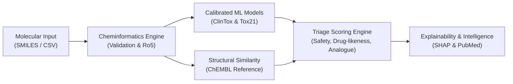

# MoleculeIQ Demonstration & Evaluation Guide

**Directive Version:** 5.0 (Research Prototype Release Candidate)  
**Target Audience:** Evaluators, Computational Chemists, Machine Learning Engineers, and Reviewers  

---

## 1. Executive Walkthrough Overview

MoleculeIQ is an AI-assisted molecular screening and cheminformatics research platform. This guide provides a step-by-step walkthrough of all platform capabilities, including both valid and invalid input behaviors, safety guardrails, calibrated machine learning inference, and literature intelligence.



---

## 2. Launching the Platform

Start the Streamlit application:
```bash
streamlit run app.py
```
Open your browser to `http://localhost:8501`.

---

## 3. Workflow A: Single Molecule Analysis

### Scenario 1: Screening an Approved Oral Drug (Aspirin)
1. In the sidebar or top navigation, select **Single Molecule Analysis**.
2. Select **"Aspirin (Analgesic)"** from the quick-load presets, or enter:
   ```
   CC(=O)Oc1ccccc1C(=O)O
   ```
3. Click **"Run Full Analysis"**.
4. **Expected Observations:**
   * **Structure Validation:** Confirmed valid formula `C9H8O4`, heavy atoms: 13.
   * **2D Vector Depiction:** High-fidelity SVG render of acetylsalicylic acid.
   * **Physicochemical Descriptors:** MW 180.16 Da, LogP 1.31, HBD 1, HBA 3, TPSA 63.60 Ų. **Lipinski Rule of 5: Pass (0 violations)**.
   * **ClinTox Prediction:** Low clinical toxicity risk with calibrated probability displayed alongside uncalibrated tree votes.
   * **Dynamic Applicability Domain:** Status displays `<span style="color:#16a34a">WITHIN_DOMAIN</span>` with maximum Tanimoto score to the training set.
   * **Tox21 Assays:** Nuclear Receptor (NR) and Stress Response (SR) pathways evaluated across 12 targets.
   * **Structural Similarity:** Highest Tanimoto similarity to approved non-steroidal anti-inflammatory reference drugs.
   * **SHAP Explainability:** Atomic attribution map highlights carboxylic and ester moieties influencing safety predictions.

---

### Scenario 2: Screening a Lipophilic Macro-Compound (Atorvastatin)
1. Select **"Atorvastatin (Lipitor - Statin)"** from the presets, or enter:
   ```
   CC(C)c1c(C(=O)Nc2ccccc2)c(-c2ccccc2)c(-c2ccc(F)cc2)n1CC[C@@H](O)C[C@@H](O)CC(=O)O
   ```
2. Click **"Run Full Analysis"**.
3. **Expected Observations:**
   * **Lipinski Evaluation:** Molecular weight > 500 Da (558.64 Da). Correctly flags Lipinski violation while maintaining oral drug context.
   * **HBA Evaluation:** Evaluated using RDKit physiological hydrogen bond acceptor rules (pyrrole/amide nitrogens non-basic/resonance-delocalized).
   * **Tox21 Multi-Assay:** Specific assay activations and inactive baselines detailed in tabular view.

---

### Scenario 3: Defensive Fault Isolation (Invalid Inputs)
1. In the SMILES input field, enter an unparseable syntax string:
   ```
   NOT_A_VALID_SMILES_STRING
   ```
2. Click **"Run Full Analysis"**.
3. **Expected Observation:**
   * The application **does not crash** or emit unhandled 500 exceptions.
   * Clean, user-facing error message appears: `Validation Failure: Failed to parse SMILES: chemically invalid structure or invalid syntax.`
   * Try entering hypervalent carbon or unbalanced rings: `C1CC` or `C(=O)(=O)(=O)O`.
   * Clear error code `E-001_MALFORMED_SMILES` is logged and displayed.

---

## 4. Workflow B: Batch Molecular Screening

### Scenario 1: Screening the Demonstration Library
1. Select **Batch Molecular Screening** in the sidebar.
2. Click **"Load Demo Batch in Memory"** (loads a 9-compound library containing valid compounds, Lipinski violators, and invalid inputs).
3. Select SMILES column `smiles` and Name column `name`.
4. Click **"Start Batch Screening"**.
5. **Expected Observations:**
   * Real-time progress bar processes each candidate.
   * **Summary Metric Cards:** Total Uploaded: 9 | Valid: 7 | Invalid: 2 | Top Priority Score.
   * **Composite Triage Ranking:** Valid compounds are ranked in descending order of Overall Priority Score ($R = 0.5S + 0.3D + 0.2M$).
   * **Fault Isolation Section:** Invalid compounds (`NOT_A_VALID_SMILES_STRING`, `C1CC`) are isolated in an expander with exact failure causes.

---

### Scenario 2: Secure Export & Formula Injection Defense
1. Click **"Download Full Enriched Screening Results (CSV)"**.
2. Open the downloaded CSV in a text editor.
3. **Verify Security Defenses:**
   * Any cell starting with formula execution characters (`=`, `+`, `-`, `@`) has been neutralized with a leading single quote (`'`), preventing CWE-1236 formula injection in spreadsheet applications.

---

### Scenario 3: Enforcing Batch Size Limits
1. Uploading a CSV exceeding 5,000 molecules triggers the built-in system guardrail:
   * Immediate user-facing message: `Uploaded file contains X rows, exceeding the maximum safe limit of 5,000 compounds.`
   * Protects browser responsiveness and server memory.

---

## 5. Workflow C: Model Transparency & Benchmarks

1. Select **Model Transparency** in the navigation.
2. Review the empirical benchmarks:
   * **ClinTox Scaffold Split:** Demonstrates generalization gap between random split (ROC-AUC ~0.89) and Bemis-Murcko scaffold split (ROC-AUC 0.771).
   * **Platt Probability Calibration:** Displays calibration curves, Brier reliability improvement (0.0522), and Expected Calibration Error (ECE: 0.1604).
   * **Tox21 12-Endpoint Matrix:** Review per-endpoint class balances, PR-AUC, and balanced accuracy metrics.

---

## 6. Workflow D: Literature Intelligence

1. Select **Literature Intelligence** in the navigation.
2. Enter a biomedical query:
   ```
   aspirin mitochondrial toxicity hepatocyte
   ```
3. Click **"Search and Extract Evidence"**.
4. **Expected Observations:**
   * Secure PubMed client queries NCBI E-utilities over TLS with Windows certificate store integration.
   * Abstract segmentation breaks texts into coherent scientific sentences.
   * Sentences are ranked by semantic relevance using TF-IDF / neural embeddings.
   * Results display exact article provenance (PMID, Authors, Year, Title, and direct clickable PubMed link).
   * Scientific disclaimer prominently alerts researchers that statements represent published literature excerpts rather than experimental confirmations.

---

## 7. Artifact Cryptographic Integrity Check

Verify the entire repository's ML artifacts programmatically from your terminal:
```bash
python -c "from src.utils.integrity import verify_artifact_checksums; res = verify_artifact_checksums(); print(f'Verified {res.verified_count} artifacts. Status: Valid={res.is_valid}')"
```
Output:
```
Verified 31 artifacts. Status: Valid=True
```
